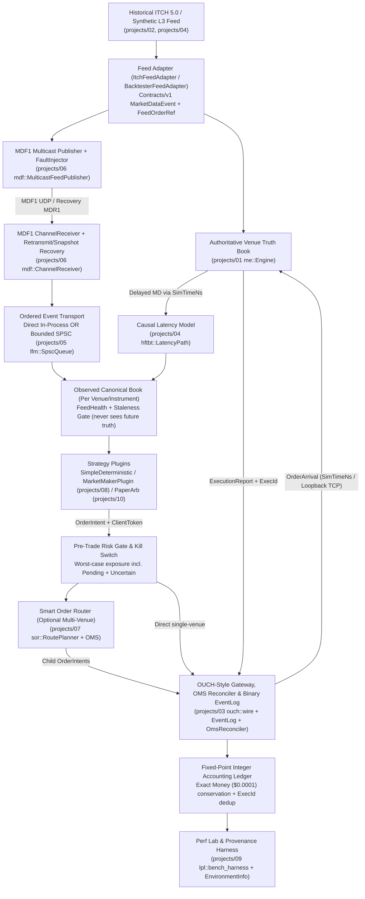
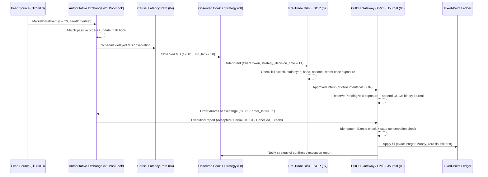
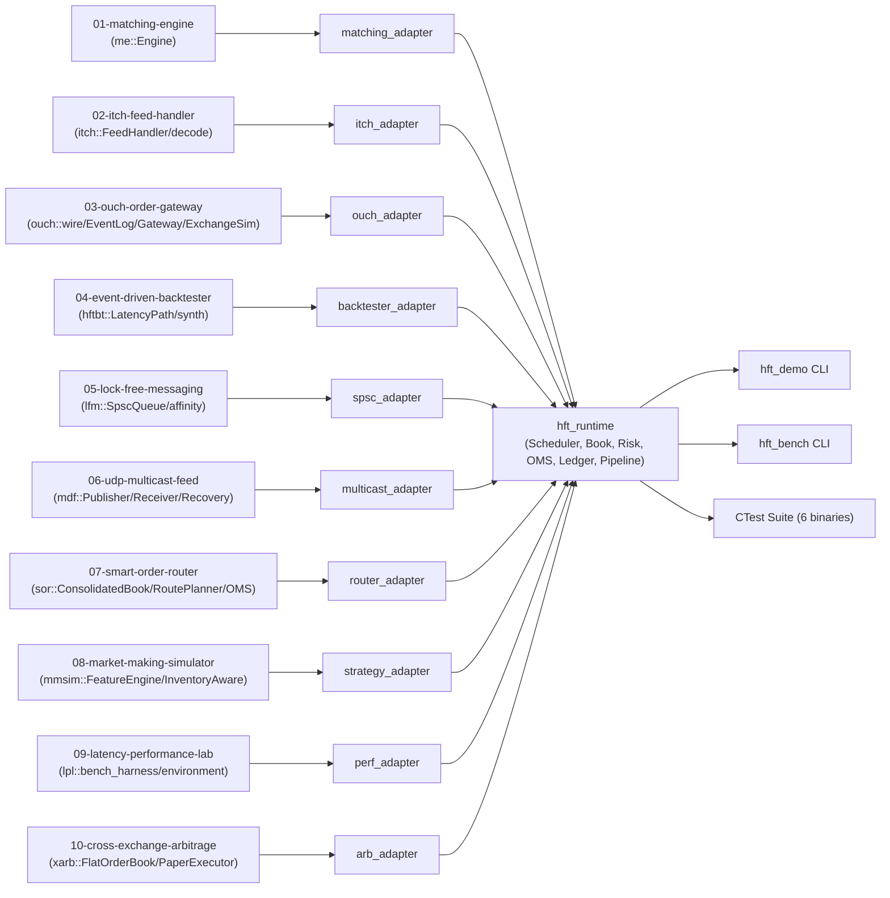

# Integrated HFT Platform — Architecture & Design Decisions

This document describes the integrated `High-Frequency-Trading-Engine` architecture (`engine/`) composing the ten independently runnable C++20 modules from [vaibhavkapur/High-Frequency-Trading](https://github.com/vaibhavkapur/High-Frequency-Trading/tree/main/projects).

**Product boundary:** Educational and systems-research trading simulator. Live exchange connectivity, production certification, and live capital deployment are explicitly out of scope.

---

## 1. End-to-End Reference Architecture

---

## 2. Order Execution & Causality Sequence

---

## 3. Module Dependency Graph

---

## 4. Runtime Modes, Clock Domains & Ownership

| Mode | Clock Type | Transport | Purpose |
|---|---|---|---|
| `deterministic` | `SimTimeNs` (`int64_t` logical ns) | Direct in-process scheduler | Replay determinism, causality, golden checksums, fault matrix, accounting checks |
| `network-lab` | Explicit wall-clock (`WallTimeNs`) + protocol sequence numbers | Loopback TCP (`ouch::Gateway` <-> `ExchangeSim`) + UDP Multicast (`mdf`) + 2-thread SPSC (`lfm`) | Packet loss/corruption/reordering recovery, TCP disconnect/reconnect, queue overflow behavior |
| `performance` | `WallTimeNs` (`steady_clock` monotonic ns) | Configured direct / SPSC / wire paths | Stage-level and E2E tail latency (`p50/p95/p99/p99.9/max`), throughput, comparative A/B |

### Ownership Invariants
- **Venue truth:** Owned exclusively by `MatchingEngineAdapter` (one per simulated venue).
- **Observed market view:** Owned by `CanonicalOrderBook` (one per `(VenueId, InstrumentId)`), fed strictly via delayed `StrategyObservation` events. Strategies receive `const IObservedMarketView&` and can never query `MatchingEngineAdapter` directly.
- **Order lifecycle:** Owned by `OmsReconciler` (mirrored to `OuchJournalBridge` when journaling is enabled).
- **Monetary balances:** Owned by `AccountingLedger` using exact integer `Money` ($0.0001 scaled units) and exact `cost_basis_scaled` tracking (`discrepancy_scaled == 0` verified across all fills).
- **SPSC queue ownership:** Strictly one producer thread calling `push()`, one consumer thread calling `try_pop()`, aligned to cache-line boundaries (`lfm::kCacheLine`: 128 B on Apple Silicon, 64 B on x86-64).

---

## 5. Architecture Decision Records (Summary)

- **ADR-001 (Authoritative Matching):** Project 01 `me::Engine<me::PoolBook>` is the single simulated matching engine (also plugged into Project 03 `ouch::sim::ExchangeSim` via `OuchMatchingBridge`). `me::MapBook` is retained as a differential oracle and A/B benchmark variant.
- **ADR-002 (Scheduler & Clock Separation):** `DeterministicScheduler` orders events strictly by `(event_time_ns, priority_class, source_sequence, insertion_sequence)`. `SimTimeNs` and `WallTimeNs` are distinct non-convertible C++ structs enforced via `static_assert`.
- **ADR-003 (Exact Integer Accounting & Worst-Case Risk):** `AccountingLedger` stores `cost_basis_scaled` in exact `$0.0001` integer units so `total_cash + mark_inventory == initial_cash + realized + unrealized - fees` holds with zero discrepancy. `OmsReconciler` keeps `PendingNew`, `PendingCancel`, and `Uncertain` orders in worst-case risk exposure until terminal confirmation.
- **ADR-004 (Protocol & ID Isolation):** ITCH 5.0 (`FeedOrderRef`), MDF1/MDR1 (`mdf::MarketEvent`), and OUCH/SoupBinTCP (`ClientToken`) remain explicitly separated across distinct adapters.
- **ADR-005 (Isolated Monorepo Composition):** `engine/cmake/UpstreamModules.cmake` compiles upstream sources into isolated `hft_upstream_*` static libraries without modifying `projects/` or invoking FetchContent.
