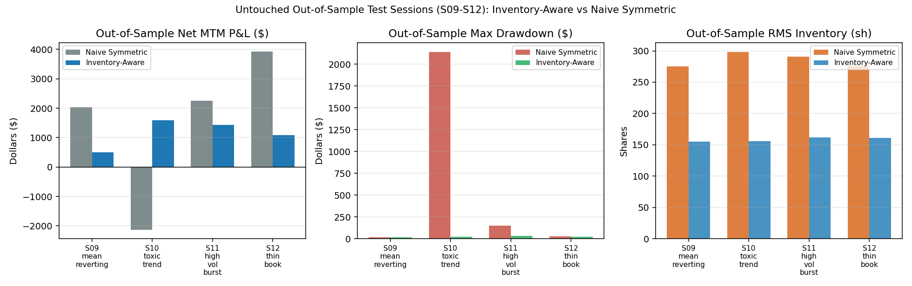
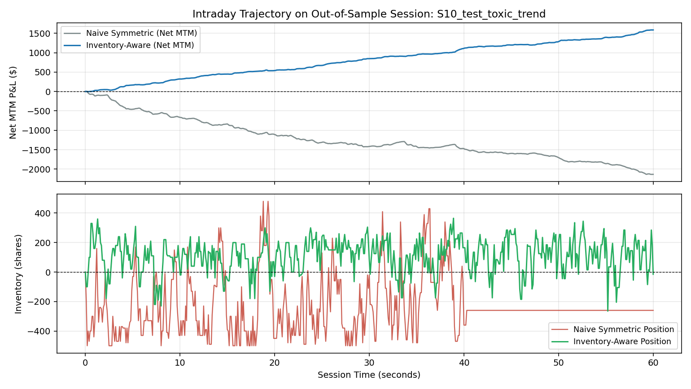
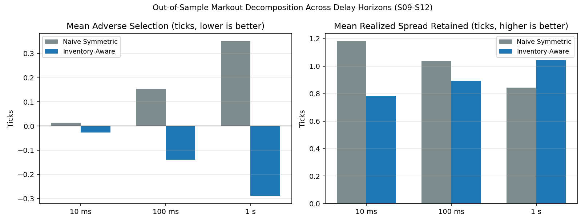
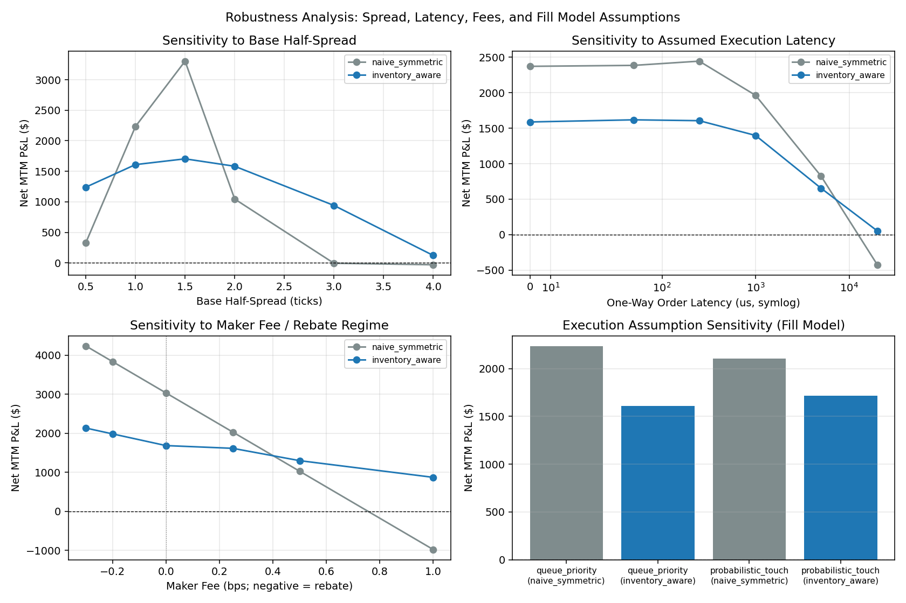

# Research Report: Inventory-Aware vs. Naive Symmetric Market Making

## Experimental Protocol

- **Sessions**: 12 deterministic 60-second synthetic L2 sessions (`S01`–`S12`, ~27,000–35,000 events each), partitioned into strict chronological splits:
  - **Train (`S01`–`S04`)**: Used *exclusively* to select `(risk_aversion, vol_spread_mult)` from a 3×3 grid via `mean(net_pnl) - 0.5 * mean(max_dd) - 0.1 * mean(rms_pos)`.
  - **Validation (`S05`–`S08`)**: Held out for out-of-sample sanity verification and robustness sweeps (no parameter tuning).
  - **Test (`S09`–`S12`)**: Strictly untouched out-of-sample sessions covering all four microstructure regimes (`mean_reverting`, `toxic_trend`, `high_vol_burst`, `thin_book`).
- **Fee & Latency Baseline**: Positive maker fee `+0.20 bps` (no rebate subsidy), taker fee `+1.50 bps`, `md_latency = 100 us`, `order_latency = 150 us`, `ack_latency = 100 us`, `max_abs_position = 500`, `max_drawdown = $1,500`, `fill_model = queue_priority`.
- **Train-Selected Parameters**: `risk_aversion = 0.6`, `vol_spread_mult = 0.25` (from `results/experiments/train_grid_search.csv`).
- **Reproduction Command**:
  ```bash
  python3 scripts/run_experiments.py
  ```

## Out-of-Sample Test Results (`S09`–`S12`)

| Session | Regime | Strategy | Fills | Gross MTM ($) | Fees ($) | Net MTM ($) | Max DD ($) | Max / RMS Pos (sh) | AdvSel 100ms (ticks) | AdvSel 1s (ticks) |
|---|---|---|---:|---:|---:|---:|---:|---:|---:|---:|
| S09 | `mean_reverting` | `naive_symmetric` | 2,695 | +2,502.05 | 466.10 | +2,035.95 | 17.32 | 500 / 275.3 | +0.056 | +0.040 |
| S09 | `mean_reverting` | `inventory_aware` | 990 | +676.05 | 171.01 | +505.04 | 17.95 | 370 / 155.4 | -0.028 | -0.088 |
| S10 | `toxic_trend` | `naive_symmetric` | 1,638 | -1,822.90 | 312.41 | **-2,135.31** | **2,142.11** (kill) | 500 / 298.3 | +0.214 | +0.699 |
| S10 | `toxic_trend` | `inventory_aware` | 752 | +1,722.13 | 135.07 | **+1,587.06** | **20.03** | 365 / 155.9 | -0.243 | -0.561 |
| S11 | `high_vol_burst` | `naive_symmetric` | 3,933 | +3,048.10 | 785.68 | +2,262.42 | 148.80 | 500 / 291.0 | +0.243 | +0.512 |
| S11 | `high_vol_burst` | `inventory_aware` | 1,595 | +1,711.40 | 272.49 | +1,438.91 | 32.34 | 390 / 162.0 | -0.165 | -0.337 |
| S12 | `thin_book` | `naive_symmetric` | 4,179 | +4,758.50 | 827.67 | +3,930.83 | 25.00 | 500 / 275.9 | +0.107 | +0.158 |
| S12 | `thin_book` | `inventory_aware` | 1,568 | +1,348.90 | 265.93 | +1,082.97 | 24.03 | 400 / 160.8 | -0.120 | -0.169 |



### Key Takeaways (Including Honest Tradeoffs)

1. **Tail Risk & Toxic Flow Protection (`S10_test_toxic_trend`)**:
   - Under informed directional flow, `naive_symmetric` suffered `+0.699 ticks` of 1-second adverse selection, accumulated pinned `500 sh` inventory (`298.3 sh` RMS), blew past its `$1,500` drawdown kill-switch, and finished at **`-$2,135.31`** net P&L (`$2,142.11` max drawdown).
   - `inventory_aware` skewed quotes away from informed order-flow imbalance and inventory buildup, keeping max drawdown at **`$20.03`** (107x lower) and finishing **`+$1,587.06`** net.
2. **Volume / Return Tradeoff in Calm Mean-Reverting Liquidity (`S09`, `S12`)**:
   - In calm sessions with minimal adverse selection, `inventory_aware` earns **less total dollar P&L** (`$505.04` vs `$2,035.95` on `S09`) because volatility spread widening and inventory skew reduce passive fill rate (`13.7%` vs `69.4%`).
   - Across all four Test sessions, `inventory_aware` traded 24.3% lower aggregate P&L (`$4,613.98` vs `$6,093.89`) for a **24.7x reduction in mean max drawdown** (`$23.59` vs `$583.31`), **44% lower RMS inventory** (`158.5 sh` vs `285.1 sh`), and **zero risk-limit rejections** (vs 19,438 on Naive).




## Robustness Sweeps (`S07_val_high_vol_burst`)



1. **Latency Sensitivity (`0 us` → `20 ms` one-way)**:
   - At `20 ms` latency, cancel races rise to `466` (Naive) and `288` (Inventory-Aware).
   - `naive_symmetric` collapses from `+$2,373.06` (`0 us`) to **`-$424.04`** (`20 ms`) as 1s adverse selection jumps from `+0.348` to `+1.281 ticks` (realized spread turns negative: `-0.373 ticks`).
   - `inventory_aware` degrades from `+$1,588.82` (`0 us`) to **`+$53.15`** (`20 ms`), remaining slightly positive because fair-value skew anticipates short-horizon flow before latency completely erodes edge.
2. **Fee Sensitivity (`-0.30 bps` rebate → `+1.00 bps` maker fee)**:
   - `naive_symmetric` loses **`-$979.69`** at `+1.00 bps` maker fee because its fixed 1-tick half-spread cannot cover fees plus adverse selection.
   - `inventory_aware` incorporates `fee_spread_mult` into its half-spread and maintains **`+$871.26`** net P&L (`$37.75` max drawdown) at `+1.00 bps`.
3. **Spread Sensitivity (`0.5` → `4.0` ticks)**:
   - Filled shares decrease strictly monotonically with spread (`417,400 → 105 sh` for Naive; `173,645 → 6,750 sh` for Inventory-Aware). Both overly tight (`0.5` tick) and overly wide (`4.0` tick) quoting degrade net P&L.
4. **Fill-Model Sensitivity (`queue_priority` vs `probabilistic_touch`)**:
   - Under `probabilistic_touch`, `inventory_aware` fills increased by 10% (`1,817` vs `1,652` fills, Net P&L `$1,715.37` vs `$1,609.20`), while the drawdown advantage over `naive_symmetric` (`$38.02` vs `$292.28`) remained consistent.

## Independent Accounting Audit

Across all 24 session runs (`results/experiments/audit_report.json`):
- Maximum P&L reconciliation error `|(cash + pos * mark) - net_mtm_pnl|`: **`1.06 × 10⁻¹¹` dollars**
- Maximum markout decomposition error `|captured_half_spread - adverse_selection - realized_spread|`: **`0.0` ticks**
- Position limit breaches across all equity samples: **`0`**
