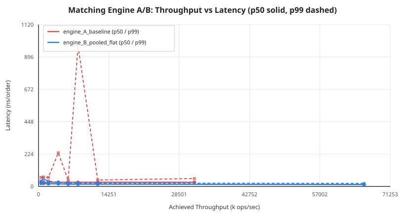

# Linux Low-Latency Benchmarking & Performance Engineering Lab

> A reproducible performance investigation of C++, CPUs, allocators, concurrency primitives, and an integrated limit-order-book matching engine.

**Project type:** Portfolio / educational systems project  
**Primary stack:** C++20, Linux `perf` (`perf_event_open`), macOS `proc_pid_rusage`, Google Benchmark (optional), `objdump`/`otool`, `taskset`/`numactl`, CMake, Python 3  
**Status:** Implemented and verified — all numbers below are measured from raw artifacts in [`results/`](results/comparison_report.md).

## Why build this?

Create credible microbenchmarks and short write-ups explaining why seemingly small design choices matter for a trading hot path, then validate whether microbenchmark wins translate into end-to-end application latency improvements on an integrated limit-order-book matching engine.

## Architecture

```text
isolated benchmark kernels -> pinned process + clock calibration -> raw CSV / JSON
                                         |                                |
                              hardware perf counters              analyze_results.py
                        (Linux perf_event_open / macOS rusage)            |
                                         \                                /
                                          automated comparison report + SVG plot
```

See [docs/architecture.md](docs/architecture.md) for the complete architecture diagram, measurement methodology, and explicit OS/hardware assumptions and limitations.

## Implemented Core Experiments

1. **AoS vs SoA (`include/lpl/aos_soa.hpp`):** Sequential bid-notional scan, single-field random lookup, and 4-field random lookup on 131,072 64-byte records (~8 MiB AoS, exceeding 6 MiB L2).
2. **Order-Book Data Structures (`include/lpl/order_book_variants.hpp`, `flat_hash_map.hpp`):** `std::map` vs contiguous sorted `std::vector` (BBO at `.back()`) vs `std::unordered_map` vs open-addressing `FlatHashMap` (SplitMix64 + backward-shift deletion) at depths 64 and 512.
3. **Allocators (`include/lpl/allocator_bench.hpp`):** Standard `new`/`delete` vs intrusive-freelist `ObjectPool<T>` vs bump-pointer `MonotonicArena` with strict C++20 lifecycle tracking (`TrackedOrder` proves `total_constructed == total_destroyed` and `live_count == 0`).
4. **Dispatch Mechanisms (`include/lpl/dispatch.hpp`):** Virtual dispatch vs function pointers vs `std::variant`/`std::visit` vs compile-time templates / static `switch` across both monomorphic and uniformly shuffled heterogeneous event streams.
5. **Branch Predictability & Cache-Line False Sharing (`include/lpl/branch_and_sharing.hpp`):** `natural_if` vs `forced_branch` (guarded against compiler if-conversion) vs `branchless_mask` on sorted vs unsorted arrays; 4-thread atomic counters aligned to 8 B, 64 B, and 128 B.
6. **Busy-Spin vs Blocking Wakeup & SPSC Handoff (`include/lpl/spsc_handoff.hpp`):** 128 B-padded lock-free SPSC ring buffer comparing `busy_spin_spsc`, `hybrid_spin_yield`, and `blocking_condvar` on tight and 50 µs-paced ping-pong workloads with explicit `CPU/Wall` burn ratios, plus pinned vs unpinned burst handoff.
7. **Integrated Matching Engine A/B Lab (`include/lpl/matching_engine.hpp`, `src/matching_engine.cpp`):** Full price-time FIFO limit/market matching engine with a validated binary wire codec comparing:
   - **Engine A (Baseline):** `std::map` price levels + `std::list` order queues + `std::unordered_map` order-ID index.
   - **Engine B (Optimized):** Pre-allocated `ObjectPool<IntrusiveOrder>` + intrusive FIFO queues + contiguous sorted price-level vectors + open-addressing `FlatHashMap` order-ID index.

## Repository Structure

```text
09-latency-performance-lab/
├── README.md
├── CMakeLists.txt
├── .clang-format
├── .github/workflows/ci.yml
├── include/lpl/                    # Public headers (harness, counters, 6 suites, matching engine)
├── src/                            # Affinity, environment, perf counters, harness, matching engine
├── tests/                          # Equivalence, concurrency, DCE/stats, binary codec & diff fuzz
├── benchmarks/                     # bench_suite, bench_matching_ab, optional bench_gbench
├── examples/                       # quick_demo.cpp and sample_config.json
├── scripts/                        # run_lab.sh, run_perf_linux.sh, run_sanitizers.sh, dump_disasm.sh, analyze_results.py
├── docs/                           # architecture.md, disassembly_analysis.md, demo.md
└── results/                        # Captured CSVs, environment.json, disassembly, comparison_report.md, SVG plot
```

## Measured Baseline & Integrated A/B Results

All figures below were computed programmatically by [`scripts/analyze_results.py`](scripts/analyze_results.py) from captured raw files in [`results/`](results/comparison_report.md).

### Benchmark Reporting Table (Integrated Matching Engine A/B)

| Field | Value |
|---|---|
| CPU / cores / topology | Apple M5 (`arm64`), 10 physical / 10 logical (4P + 6E), 128 B cache line |
| Caches (L1d / L2 / L3) | 64 KiB / 6144 KiB / 0 KiB |
| OS / kernel | macOS 26.5.1 (Darwin kernel 25.5.0) |
| Compiler / version / flags | AppleClang 21.0.0.21000101 (`Release`, `-O3 -DNDEBUG`, `-march=native`: OFF) |
| Dataset / event mix / sample count | 200,000 deterministic mixed orders (limits, crosses, markets, cancels, modifies; 82,723 trades), 7 interleaved AB repetitions, 32-order latency batches (43,750 samples/engine) |
| Warmup / affinity / governor | 1 full warmup pass per engine / macOS QoS=`USER_INTERACTIVE` + affinity tag 1 / OS-managed DVFS |
| Engine A (`std::map` + `std::list` + `std::unordered_map`) | **25.60 Mops/s** · p50 **39.06 ns** / p99 **63.81 ns** / p99.9 **101.88 ns** · 159.89 cyc/op · 542.40 ins/op (IPC 3.39) · Rep CV 9.86% |
| Engine B (`ObjectPool` + intrusive + sorted vector + `FlatHashMap`) | **48.05 Mops/s** · p50 **20.81 ns** / p99 **31.25 ns** / p99.9 **40.38 ns** · 86.59 cyc/op · 194.26 ins/op (IPC 2.24) · Rep CV 7.08% |
| Computed A/B Speedup (B vs A) | **1.88x** p50 · **2.04x** p99 · **2.52x** p99.9 · **2.79x** fewer retired instructions/order · bit-for-bit identical trade checksum (`4878581049783654324`) |
| Raw results and reproduction command | [`results/comparison_report.md`](results/comparison_report.md), [`results/matching_ab_summary.csv`](results/matching_ab_summary.csv), [`results/throughput_vs_latency.svg`](results/throughput_vs_latency.svg) — run `./scripts/run_lab.sh` |

### Selected Microbenchmark Highlights (from [`results/comparison_report.md`](results/comparison_report.md))

| Investigation | Baseline | Optimized / Alternative | Measured Effect (p50) | Hardware / Systems Mechanism |
|---|---|---|---|---|
| AoS vs SoA (seq scan) | `aos_64B`: 0.60 ns (2.45 cyc/op) | `soa_split`: 0.47 ns (1.34 cyc/op) | **1.27x faster** (p99 **5.28x** tighter) | NEON SIMD vectorization + skipping cold fields (IPC 2.76 → 5.38) |
| AoS vs SoA (random 4-field) | `aos_64B`: 0.99 ns (3.96 cyc/op) | `soa_split`: 1.87 ns (8.09 cyc/op) | **0.53x (AoS wins 1.89x)** | AoS fetches 4 fields in 1 cache line vs 4 separate column misses |
| Order book (depth 512) | `std_map`: 14.11 ns (166 ins/op) | `sorted_vector`: 11.04 ns (113 ins/op) | **1.28x faster** (`flat_hash_map` 0.09x) | Contiguous memory beats RB-tree; hash tables penalize top-K scans |
| Allocator churn (16k ops) | `heap_new_delete`: 9.77 ns (225 ins/op) | `object_pool`: 2.11 ns (32 ins/op) | **4.63x faster** (`arena` **2.87x**) | Intrusive freelist eliminates malloc/free overhead |
| Dispatch (heterogeneous) | `virtual_dispatch`: 4.99 ns | `static_switch`: 2.36 ns (`fn_ptr`: 3.78 ns) | **2.11x faster** (`variant`: 0.78x) | Inlined jump table vs indirect vtable branch misprediction |
| Branching (unsorted 64k) | `forced_branch`: 2.33 ns (10.10 cyc/op, IPC 0.60) | `natural_if` / `branchless`: 0.06 ns (0.25 cyc/op) | **38.8x faster** | Clang auto-vectorizes `natural_if` into NEON `cmhs.4s` + `and.16b` |
| False sharing (4 threads) | `align_8B`: 2.51 ns (35.96 cyc/op, IPC 0.18) | `align_128B`: 0.42 ns (7.11 cyc/op, IPC 0.88) | **5.92x faster** (`align_64B`: 0.58 ns, 55% CV) | Apple Silicon 128 B cache line causes residual sharing at 64 B |
| SPSC handoff (50 µs paced) | `busy_spin_spsc`: 104 ns p50 (0.85 CPU/Wall) | `blocking_condvar`: 1,417 ns p50 (0.09 CPU/Wall) | **13.6x lower latency vs 9.4x lower CPU** | Explicit latency-vs-CPU tradeoff quantified |

See **[docs/disassembly_analysis.md](docs/disassembly_analysis.md)** for the full Milestone M4 disassembly investigation (including actual ARM64 assembly from `objdump -d -C`).



## Local Development

```bash
# Build Release and run unit, concurrency, DCE, and binary-codec fuzz tests
cmake -S . -B build -DCMAKE_BUILD_TYPE=Release
cmake --build build -j
ctest --test-dir build --output-on-failure

# Run standalone quick demo
./build/examples/quick_demo

# Run ASan + UBSan and TSan
./scripts/run_sanitizers.sh

# Run full reproducible benchmark suite, disassembly capture, and report/SVG generator
./scripts/run_lab.sh

# Optional: build with Google Benchmark
cmake -S . -B build-gbench -DCMAKE_BUILD_TYPE=Release -DLPL_BUILD_GBENCH=ON
cmake --build build-gbench --target bench_gbench -j

# On Linux with perf, taskset, and numactl:
./scripts/run_perf_linux.sh
```

See [docs/demo.md](docs/demo.md) for captured terminal output of the complete workflow.

## Definition of Done

- [x] Working implementation with a documented supported feature/protocol subset
- [x] Unit, integration, negative-case and replay/stress tests (plus ASan+UBSan, TSan, and binary-codec differential fuzzing)
- [x] Reproducible benchmark script (`scripts/run_lab.sh`) and captured machine/environment metadata (`results/environment.json`)
- [x] Measured performance tradeoffs across 6 microbenchmark domains and an integrated A/B matching engine, with raw CSV results
- [x] Architecture diagram and explicit assumptions/limitations ([docs/architecture.md](docs/architecture.md))
- [x] Captured terminal demo showing the complete workflow ([docs/demo.md](docs/demo.md))
- [x] CI that builds, runs tests, sanitizers, and checks formatting ([.github/workflows/ci.yml](.github/workflows/ci.yml))

## CV Bullet (backed by captured raw results)

> Created a reproducible C++20/Linux performance lab comparing memory layouts, allocators, dispatch, branching, false sharing, and lock-free SPSC handoff with hardware performance counters and ARM64 disassembly analysis; applied object-pool + flat-hash + intrusive price-level optimizations to an integrated matching engine, reducing p50 latency by **1.88x** (39.06 → 20.81 ns/order), p99 latency by **2.04x** (63.81 → 31.25 ns/order), and retired instructions/order by **2.79x** (542 → 194) with verified bit-for-bit trade equivalence.

## Caveats / Non-Goals

- All published results are actual measurements captured in [`results/`](results/); no third-party blog numbers are used.
- `-march=native` is disabled by default (`LPL_MARCH_NATIVE=OFF`) and explicitly recorded in `environment.json` when enabled.
- Sub-100 ns microbenchmarks use batching (`ops_per_sample`) and explicit clock-overhead calibration (`19.17 ns` median on Apple M5) to avoid single-call timer quantization.
- macOS XNU does not expose unprivileged LLC/branch-miss PMU counters or hard userspace core pinning; `src/perf_counters.cpp`, `src/affinity.cpp`, and `scripts/run_perf_linux.sh` provide native Linux `perf_event_open(2)` + `taskset`/`numactl` support when run on Linux.

This is an educational portfolio system. It is not a certified exchange integration, investment advice, or authorization to connect to a real trading venue.
