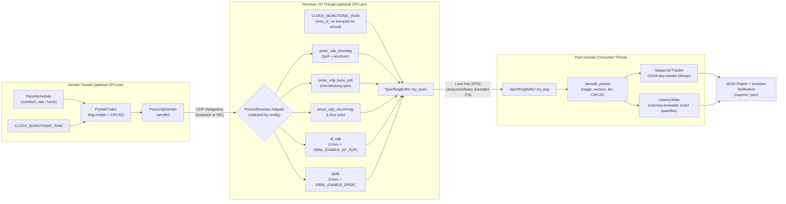

# Architecture — Kernel Bypass Networking Lab

## 1. Design Boundaries

The codebase enforces strict separation between three layers so that identical market-data payloads and sequence-accounting logic execute across every receive path:

1. **Pure Domain Layer (I/O-free, deterministic)**
   - `include/kbnl/protocol.hpp` / `src/protocol.cpp` — Explicit big-endian wire codec with IEEE 802.3 CRC32 validation and deterministic splitmix64 payload generation.
   - `include/kbnl/ring_buffer.hpp` — Cache-line aligned, lock-free single-producer single-consumer (SPSC) bounded ring buffer (`SpscRingBuffer<T>`).
   - `include/kbnl/sequence_tracker.hpp` / `src/sequence_tracker.cpp` — Deterministic 1-based sequence state machine with a 1,024-sequence sliding reorder bitmap.
   - `include/kbnl/latency_stats.hpp` / `src/latency_stats.cpp` — Exact quantile collector (up to 2,000,000 samples) with deterministic log-linear histogram fallback and warmup exclusion.
   - `include/kbnl/pacer.hpp` / `src/pacer.cpp` — Pure constant-rate and burst pacing schedule calculations.

2. **Transport Adapter Layer (OS / NIC / Bypass isolated)**
   - `include/kbnl/transport.hpp` — `PacketReceiver`, `PacketSender`, `CapabilityReport`, and structured `StatusCode` error model.
   - `include/kbnl/posix_udp_transport.hpp` / `src/posix_udp_transport.cpp` — Baseline POSIX UDP `poll()+recvfrom()` blocking path, non-blocking busy-poll `recvfrom()` path, Linux `recvmmsg()` batched path, and paced UDP sender.
   - `include/kbnl/af_xdp_transport.hpp` / `src/af_xdp_transport.cpp` — Feature-gated (`KBNL_ENABLE_AF_XDP`) Linux `AF_XDP` UMEM/fill/completion/RX ring adapter with Ethernet/IPv4/UDP extraction and explicit runtime capability probing.
   - `include/kbnl/dpdk_transport.hpp` / `src/dpdk_transport.cpp` — Feature-gated (`KBNL_ENABLE_DPDK`) Linux DPDK EAL/mbuf/ethdev `rte_eth_rx_burst()` adapter with explicit runtime capability probing.

3. **Harness & Observability Layer**
   - `include/kbnl/clock.hpp` / `src/clock.cpp` — Documented `CLOCK_MONOTONIC_RAW` clock source and call-overhead calibration.
   - `include/kbnl/cpu_affinity.hpp` / `src/cpu_affinity.cpp` — Thread pinning (`pthread_setaffinity_np` on Linux; explicit advisory/unsupported reporting on macOS) and topology discovery.
   - `include/kbnl/benchmark_runner.hpp` / `src/benchmark_runner.cpp` — Coordinates warmup, measurement window, EOS draining, SPSC handoff, fixture replay, and verification.
   - `include/kbnl/json_writer.hpp` / `src/json_writer.cpp` — Machine-readable JSON report serialization.

## 2. Component and Data-Flow Diagram

## 3. Core Invariants and Memory Ordering

### 3.1 Lock-Free SPSC Ring Buffer (`SpscRingBuffer<T>`)
- **Bounded capacity:** Must be a power of two `>= 2`. Invalid capacities throw `std::invalid_argument` and are rejected by config validation.
- **False-sharing avoidance:** `tail_`, `head_`, and `dropped_` reside on distinct 64-byte aligned cache lines (`alignas(64)`).
- **Memory ordering:**
  - Producer loads `tail_` (`relaxed`) and `head_` (`acquire`), writes `storage_[tail & mask]`, and publishes `tail_ + 1` (`release`).
  - Consumer loads `head_` (`relaxed`) and `tail_` (`acquire`), moves from `storage_[head & mask]`, and publishes `head_ + 1` (`release`).
- **Backpressure:** Never blocks the I/O thread; when full (`tail - head >= capacity`), increments `dropped_` (`relaxed`) and returns `false`, propagating into `SequenceCounters::ring_drops`.

### 3.2 Exact Sequence Accounting (`SequenceTracker`)
For every 1-based data sequence stream (`seq >= 1`):
- `total_valid_data_packets == unique_received + duplicates + too_old_out_of_window`
- `unique_received + missing_within_highest == highest_seq` (when `highest_seq > 0`)
- Against a known sender count `S`: `unique_received + inferred_total_lost == S`
- A 1,024-bit sliding bitmap behind `highest_seq` resolves delayed out-of-order arrivals (decrementing `missing_within_highest` and incrementing `out_of_order`) versus duplicates (incrementing `duplicates` without distorting latency).
- End-of-stream (`kFlagEndOfStream`) control frames carry `seq_num = 0` and never pollute data sequence counters or latency samples.

### 3.3 Timestamping and Clock Semantics
- `send_ts_ns` is stamped immediately before `sendto()` using `CLOCK_MONOTONIC_RAW`.
- `recv_ts_ns` is stamped immediately on packet extraction in `poll_batch()` (prior to SPSC enqueue) so reported latency measures receive-path delivery rather than consumer thread wakeup jitter.
- Latency deltas are valid **only** within a single host clock domain. Cross-host latency requires hardware timestamping (`SO_TIMESTAMPING` / PTP) and is explicitly flagged via `same_host_domain_required: true`.

## 4. Key Trade-Offs

| Decision | Chosen Approach | Trade-Off |
|---|---|---|
| Wire encoding | Explicit big-endian byte reads/writes + CRC32 | Eliminates UB/alignment issues across ARM64/x86_64 at minor CPU cost (~15 ns CRC32 for 64 B) |
| Unsupported bypass backends | Explicit `NOT_RUN` + `StatusCode` failure | Prevents misleading simulated hardware metrics; requires Linux + NIC for AF_XDP/DPDK numbers |
| Quantile computation | Exact sorted vector up to 2M samples + log-linear bucket fallback | Exact p50/p99/p99.9 on benchmark runs while bounding memory for long runs |
| Zero external test/JSON deps | Self-contained C++20 test harness and strict JSON parser/writer | Offline, zero-network CMake builds on macOS and Linux with no third-party license sprawl |
