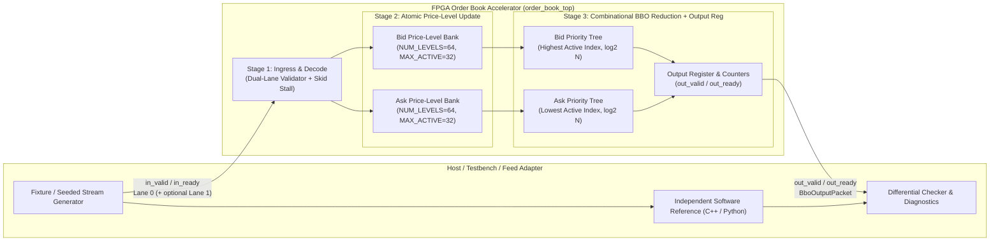

# Architecture — FPGA Order Book Accelerator

## 1. High-Level Component Diagram



## 2. Pipeline Timing and Hazard-Free Invariants

The accelerator is organized as a **3-stage synchronous pipeline** with global backpressure stall (`pipe_advance = !out_valid || out_ready`):

| Stage | Register Boundary | Operations Performed |
|---|---|---|
| **Stage 1 (Ingress / Decode)** | `s1_reg` | Accepts Lane 0 (and optional Lane 1) when `in_valid && in_ready`. Decodes opcode, side, price index, schema version, and flags. |
| **Stage 2 (State Update)** | `bank_regs` + `s2_meta` | Atomically validates bank-dependent conditions (capacity, overflow, underflow) and commits Lane 0 then Lane 1 to `bid_bank` and `ask_bank` on the same clock edge. |
| **Stage 3 (BBO Extract & Output)** | `out_reg` | Combinational binary reduction tree (`bbo_tree`) inspects post-Stage-2 `active_mask` and level arrays to extract Best Bid / Best Ask, spread, and crossed flag, latching into `out_reg`. |

### Cycle-by-Cycle Pipeline Diagram (`II = 1`, `Latency = 3` cycles)

```text
Cycle:      0       1       2       3       4       5
Event E0: [S1:Dec][S2:Upd][S3:BBO][OUT]
Event E1:         [S1:Dec][S2:Upd][S3:BBO][OUT]
Event E2:                 [S1:Dec][S2:Upd][S3:BBO][OUT]
```

### Key Hardware Invariants

1. **Zero Read-After-Write (RAW) / Write-After-Write (WAW) Pipeline Hazards:**  
   Because all state mutations commit at the end of Stage 2 while the immediately following event sits in Stage 1, every event entering Stage 2 always observes the fully committed bank state of all preceding events. No bypass muxes or pipeline bubbles are required between back-to-back events on the same price level.
2. **Exact Post-Event BBO Snapshot Under Arbitrary Backpressure:**  
   During Stage 3, `bbo_tree` reads `bank_regs`, which holds the exact post-update state for the event currently in `s2_meta`. On the rising clock edge when `pipe_advance == 1`, `out_reg` samples `bbo_tree(bank_regs)` **simultaneously** with `bank_regs` updating for the next event in `s1_reg` (non-blocking assignment semantics). When `pipe_advance == 0` (`out_valid && !out_ready`), all three stages and `bank_regs` freeze identically—preventing lost, duplicated, or torn BBO snapshots.
3. **Deterministic Simultaneous-Update Equivalence:**  
   When `lane0` and `lane1` arrive in the same clock cycle, Stage 2 evaluates `apply(apply(S, lane0), lane1)` combinationally before latching `bank_regs`. Whether the two events hit opposite sides, distinct levels on the same side, or the exact same `(side, price)`, the post-cycle state is bit-exact with sequential execution.
4. **Synchronous Active-Low Reset (`rst_n == 0`):**  
   Clears all pipeline valid flags (`s1_valid`, `s2_valid`, `out_valid`), all price-level quantities, order counts, active masks, active level counts, and diagnostic counters in a single clock cycle. In-flight pipeline events at the moment of reset are cleanly discarded without corrupting post-reset transactions.

## 3. Architectural Variants Compared in Benchmarks

To evaluate the pipelined hardware design against a simple baseline on identical seeded event streams:

| Variant | Pipeline Depth | Initiation Interval (`II`) | BBO Extraction | Ingress Lanes |
|---|---|---|---|---|
| `baseline_fsm` | Non-pipelined (3-state FSM) | `3.0` cycles/event | Sequential scan/FSM commit | 1 |
| `pipelined_1lane` | 3 stages | `1.0` cycles/event | Parallel `O(log2 N)` binary tree | 1 |
| `pipelined_2lane` | 3 stages | `0.5` cycles/event (paired) | Parallel `O(log2 N)` binary tree | 2 (simultaneous) |

## 4. Trade-Offs and Limitations

- **Direct-Indexed Bounded Table vs. CAM/Hash Table:** Direct indexing by `price - PRICE_BASE` guarantees `O(1)` deterministic latency and avoids hash collisions, at the cost of bounding price coverage to `NUM_LEVELS` contiguous ticks around `PRICE_BASE`.
- **Single-Cycle Combinational `bbo_tree` Scaling:** At `NUM_LEVELS = 64`, the 6-level 2:1 binary tree fits comfortably inside a single 250–300 MHz FPGA clock period (target estimate; not measured on silicon). Scaling to `NUM_LEVELS >= 512` would require inserting an additional pipeline register mid-tree (`Latency = 4` cycles, `II = 1`).
- **L2 Aggregate Book Only:** Individual `order_id` tracking (L3 book) is intentionally outside scope; keeping the structure bounded per price level makes state size `O(NUM_LEVELS)` registers/LUTRAM.
- **Simulation vs. Silicon:** Cycle counts are exact in RTL/cycle-accurate simulation, whereas wall-clock latency in nanoseconds depends on target FPGA part, synthesis/P&R timing closure, and I/O serdes latency (none of which are claimed as measured here).

See [ADR-0001](adr/0001-bounded-pipelined-order-book-architecture.md) for the recorded architectural decision rationale.
