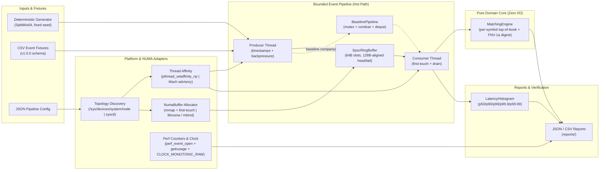

# NUMA-Aware Trading Engine — Architecture

## 1. Component Overview

The engine separates hot-path lock-free data structures, OS/NUMA platform adapters, pure domain state transitions, and benchmark/CLI harnesses into isolated layers.

## 2. Data Flow

1. **Configuration & Topology Discovery:** `detect_topology()` probes the host OS, logical/physical CPU counts, cache-line size, page size, memory size, and NUMA nodes (`nodes[]` with CPU lists and distance matrix). Every `PipelineConfig` is validated against `TopologyInfo` before execution.
2. **Thread Setup & First-Touch Allocation:**
   - The `SpscRingBuffer<MarketEvent>` reserves a page-aligned anonymous mapping via `NumaBuffer::allocate()`.
   - When `MemoryPolicy::kFirstTouchLocal` is selected, physical page faulting is deferred (`defer_first_touch = true`).
   - Producer and consumer threads start, apply CPU affinity (`pin_current_thread()`), and the owning worker thread invokes `ring.first_touch_from_current_thread()` to fault all pages onto its local NUMA node **before** the start barrier releases traffic.
   - On Linux with `libnuma` (or `SYS_mbind`), `kLocal`, `kRemote`, and `kInterleaved` explicitly bind virtual pages to the requested node(s).
3. **Warm-up & Measured Event Streaming:**
   - Warm-up events (`flags & kEventFlagWarmup`) traverse the exact same hot path (warming instruction caches, TLBs, branch predictors, and ring slots) and update the domain `MatchingEngine`, but are excluded from latency histograms and throughput denominators.
   - Each measured `MarketEvent` (64 bytes) is stamped with `MonotonicClock::now_ns()` immediately before enqueue, stamped again upon dequeue (`recv_ts_ns`), processed by `MatchingEngine::process()`, and stamped upon completion (`done_ts_ns`).
4. **Deterministic Verification:**
   - `MatchingEngine` folds every domain state transition (excluding wall-clock timestamps) into a 64-bit FNV-1a `final_state_digest`.
   - `run_comparison_suite()` checks that every executed placement matches the baseline `final_state_digest` bit-for-bit and records `lost_events == 0`.

## 3. Invariants and Memory Ordering

| Invariant | Enforcement Mechanism |
|---|---|
| **Fixed-size cache-aligned messages** | `static_assert(sizeof(MarketEvent) == 64)`, `alignas(64)`, trivially copyable, standard layout. |
| **Bounded capacity** | SPSC ring requires power-of-two capacity in `[8, 4194304]`; baseline mutex queue enforces `queue.size() < capacity`. |
| **Zero lost events** | Producer blocks/spins on full queue (`push_blocking` / `cv_not_full`); consumer drains exact `total_events`; post-run assertion returns `ErrorCode::kEventLossDetected` on any mismatch. |
| **Strict FIFO & Acquire-Release ordering** | Producer writes `slots_[tail & mask]` then executes `tail.store(tail + 1, std::memory_order_release)`. Consumer executes `tail.load(std::memory_order_acquire)`, reads the slot, then executes `head.store(head + 1, std::memory_order_release)`. Producer executes `head.load(std::memory_order_acquire)` only when its cached snapshot indicates the ring may be full. |
| **No false sharing** | `ProducerState` and `ConsumerState` are each `alignas(128)` (`kCacheLineSize = 128`), covering both 64-byte x86-64 lines and 128-byte Apple Silicon / Intel spatial-prefetcher pairs. |
| **Honest capability reporting** | Single-node or non-Linux hosts never silently report cross-node NUMA execution or enforced hard pinning; scenarios are labeled `UNAVAILABLE_SINGLE_NODE`, `FALLBACK_SINGLE_NODE`, or `UNAVAILABLE_PLATFORM`. |

## 4. Key Trade-offs

- **Busy-wait spinning vs. blocking sleep:** `SpscRingBuffer` uses `MonotonicClock::cpu_relax()` (`pause` on x86-64, `yield` on ARM64) to achieve predictable low tail latency at the cost of dedicated core utilization. `BaselinePipeline` uses `std::mutex` + `std::condition_variable` as a like-for-like OS-scheduled contrast.
- **Unthrottled burst vs. paced arrival:** In unthrottled throughput mode (`bench_placements`), the producer saturates the bounded ring (`capacity = 4096`), so per-event latency reflects Little's Law queueing delay (`capacity / throughput`, e.g., ~380–480 µs at ~10.5M events/s) rather than unloaded hop latency. For unloaded/low-queue-depth latency, run with small batches or lower capacity (e.g., `fixtures/valid_small_events.csv` shows ~709 ns median e2e latency).
- **Optional external libraries:** `libnuma` and Google Benchmark are detected dynamically by CMake so the project builds cleanly offline on any POSIX/macOS/Linux host while unlocking native Linux NUMA APIs and Google Benchmark targets when installed.

See [ADR-001](adr/001-lock-free-spsc-and-numa-abstraction.md) for the recorded design rationale.
