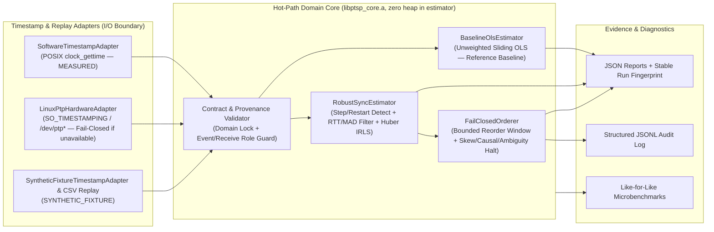

# Architecture — Precision Time Synchronization Platform (`ptsp`)

## 1. High-level overview

`ptsp` separates deterministic hot-path synchronization & ordering logic (`libptsp_core.a`) from OS/hardware timestamp adapters, offline replay I/O, and benchmark harnesses.

## 2. Data flow and component boundaries

1. **Contract & Provenance Boundary (`include/ptsp/types.hpp`, `src/contracts.cpp`)**
   - Every timestamp is a `ProvenancedTimestamp` carrying `value_ns`, non-negative `uncertainty_ns`, and `ClockProvenance` (`domain`, `role`, `capture_method`, `error_source`, `clock_id`, `epoch_id`).
   - `TimestampedPacket` separates `event_ts` (role MUST be `EVENT_TIME`) from `receive_ts` (role MUST be `RECEIVE_TIME`).
   - `require_same_domain` enforces that timestamps from different clock domains (e.g., `TAI` vs `UTC` vs `MONOTONIC_RAW`) are never silently compared or subtracted.

2. **Bounded Hot-Path Estimators (`include/ptsp/ring_buffer.hpp`, `include/ptsp/estimator.hpp`, `src/estimator.cpp`)**
   - Uses a fixed-capacity stack-allocated `BoundedRingBuffer<Point, 128>` with zero dynamic allocations during `update()`.
   - **Baseline (`BaselineOlsEstimator`)**: Unweighted sliding-window ordinary least squares on two-way offset $\theta_i = \frac{(T_2 - T_1) - (T_4 - T_3)}{2}$. Kept strictly for like-for-like comparison on identical event streams.
   - **Optimized / Robust (`RobustSyncEstimator`)**:
     - **Domain lock**: Locks `(reference_domain, local_domain)` on first valid sample; rejects cross-domain samples with `CLOCK_DOMAIN_MISMATCH`.
     - **Restart detector**: Detects `epoch_id` increments or local counter regression ($T_{2,i} < T_{2,i-1}$ while $T_{1,i} \ge T_{1,i-1}$), cleanly resetting the window and `min_rtt_ns` into a new estimator epoch.
     - **Clock step detector**: Distinguishes sustained clock steps (large offset residual without an RTT spike, confirmed across `step_confirm_count` consecutive consistent samples) from single-packet queuing outliers.
     - **Outlier & asymmetry filter**: Rejects RTT spikes ($\text{rtt} > f \cdot d_{\min} + \text{slack}$) and MAD-scaled residual outliers before fitting.
     - **Bounded Huber IRLS**: 4-iteration weighted linear regression (inverse excess-RTT × Huber weights) estimates offset $\hat{\theta}$ (ns) and drift $\hat{r}$ (ppb) anchored at `anchor_ref_ns` to avoid floating-point cancellation on $10^{18}$-scale nanosecond timestamps.
     - **Uncertainty decomposition**: Reports conservative half-width `total_uncertainty_ns = measurement_noise_ns + asymmetry_bound_ns + 3 * residual_std_ns`, where `asymmetry_bound_ns` derives from the fundamental PTP delay-asymmetry bound $\frac{\text{rtt} - d_{\min}}{2}$.

3. **Fail-Closed Orderer (`include/ptsp/fail_closed_orderer.hpp`, `src/fail_closed_orderer.cpp`)**
   - Enforces strict `expected_event_domain` and `expected_receive_domain`.
   - Aligns `receive_ts` into the event domain using `align_local_to_reference`, propagating both estimator uncertainty and drift extrapolation uncertainty.
   - Checks three invariants on every packet:
     1. **Skew envelope**: `estimate.total_uncertainty_ns <= max_skew_ns` and `combined_uncertainty_ns <= max_skew_ns`.
     2. **Receive-after-event causality**: `aligned_receive_ns - event_time_ns + combined_uncertainty_ns + max_causal_slack_ns >= 0`.
     3. **Cross-source causal decidability**: When `fail_closed_on_ambiguity` is enabled, overlapping event-time uncertainty intervals `[t_a - u_a, t_a + u_a]` and `[t_b - u_b, t_b + u_b]` between distinct `source_id`s halt the orderer fail-closed (`AMBIGUOUS_ORDERING`) instead of guessing order.
   - Bounded memory capacity (`max_buffered_events`): returns `BUFFER_CAPACITY_EXCEEDED` instead of unbounded allocation or silent drops.
   - Once `HALTED_FAIL_CLOSED`, all subsequent `ingest()` and `flush()` calls fail closed with `FAIL_CLOSED_HALTED` until explicit operator intervention (`recover_and_reset_buffer()`).

4. **Timestamp Adapters (`include/ptsp/adapters.hpp`, `src/adapters.cpp`)**
   - `SoftwareTimestampAdapter`: Measures actual POSIX `clock_getres` and `clock_gettime` call latency and `CLOCK_REALTIME` vs `CLOCK_MONOTONIC` jitter (`ErrorSource::Measured`). Explicitly refuses `TAI` and `EXCHANGE_VENUE` domains.
   - `LinuxPtpHardwareAdapter`: Probes `/dev/ptp*` and `ETHTOOL_GET_TS_INFO` (`SOF_TIMESTAMPING_RAW_HARDWARE`) on Linux. Fails closed with `HARDWARE_TIMESTAMP_UNAVAILABLE` on non-Linux hosts or NICs without active PHC/hardware timestamping.
   - `SyntheticFixtureTimestampAdapter`: Deterministic offline schedule tagged `SYNTHETIC_FIXTURE`.

## 3. Invariants and trade-offs

| Invariant / Design Choice | Rationale | Trade-off |
|---|---|---|
| Never silently mix clock domains | TAI vs UTC differ by 37 s (leap seconds); monotonic vs wall clocks have arbitrary offsets | Requires explicit provenance metadata on every input record |
| 2-sample confirmation for clock steps (`step_confirm_count=2`) | Prevents single-packet delay outliers from falsely resetting the estimator window | Introduces a 1-sample confirmation lag on genuine clock steps |
| Fail-closed halt on skew/causal/ambiguity violations | Prevents emitting misordered market events during sync faults | Reduces availability during severe clock faults until operator recovery |
| Zero external C++ library dependencies | Ensures deterministic offline builds across Linux and macOS | Uses focused hand-written CSV/KV/JSON serialization instead of general-purpose parsers |
