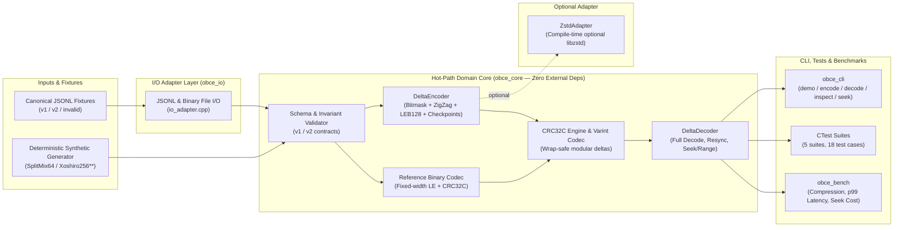
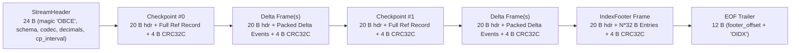

# Architecture — Order Book Compression Engine

## 1. Component Overview

The engine strictly separates hot-path domain codecs (`obce_core`), optional external compression adapters (`ZstdAdapter`), I/O & JSONL serialization (`obce_io`), CLI tooling (`obce_cli`), and benchmark/test harnesses.

## 2. Wire Format Layout

### Frame Integrity & Bounds
- Every frame starts with a 20-byte header (`frame_magic=0x4F42`, `frame_type`, `flags`, `payload_length`, `event_count`, `first_seq_id`) and ends with a 4-byte Castagnoli CRC32C computed over `[header || payload]`.
- Bounded capacity guards reject any frame claiming `payload_length > 16 MiB` or `event_count > 65,536` before allocating or reading payload memory.

### Delta Encoding Mechanics
Each delta event compares against the immediately preceding event (`prev`):
- **1-byte `core_mask`**:
  - Bit 0: `seq_id != prev.seq_id + 1` (0 bytes on wire for contiguous sequence IDs)
  - Bit 1: `timestamp_ns != prev.timestamp_ns` (ZigZag LEB128)
  - Bit 2: `symbol_id != prev.symbol_id` (ZigZag LEB128)
  - Bit 3: `order_id != prev.order_id` (ZigZag LEB128)
  - Bit 4: `price_ticks != prev.price_ticks` (wrap-safe ZigZag LEB128)
  - Bit 5: `quantity != prev.quantity` (wrap-safe ZigZag LEB128)
  - Bit 6: metadata/level changed (1 packed byte + optional LEB128 `level_index`)
  - Bit 7: schema v2 extension changed (1-byte `ext_mask` + changed `venue_id`, `flags`, `match_id`)

## 3. Core Invariants

1. **Lossless roundtrip:** For every valid event stream, `decode(encode(events)) == events` field-for-field and yields identical canonical CRC32C digests.
2. **No silent corruption:** Every CRC mismatch, truncation, varint overflow (>64 bits), invalid enum value, or sequence regression fails explicitly with a typed `ErrorCode`.
3. **No silent delta drift on frame loss:** Each `Delta` frame header embeds `first_seq_id`. If an earlier delta frame was dropped, the decoded first event's `seq_id` mismatches `frame.first_seq_id`, halting delta application immediately rather than applying deltas to stale price/order state.
4. **Bounded random-access scan:** With `IndexFooter` enabled, `seek_by_seq_id` performs `O(log C)` binary search over checkpoints and decodes at most `checkpoint_interval` events.
5. **No signed overflow UB:** Signed 64-bit deltas use modular unsigned arithmetic (`uint64_t(cur) - uint64_t(prev)`), guaranteeing safe transitions across `[INT64_MIN, INT64_MAX]`.

## 4. Engineering Trade-Offs

| Dimension | Choice Made | Alternative Considered | Rationale |
|---|---|---|---|
| **Checkpoint interval** | Configurable (`64..4096`, default `256`) | Fixed interval or single stream-start anchor | Lets operators tune space (~12–13.5 B/ev) vs random-access p99 (2.5–137 µs) and blast radius on frame loss |
| **Delta encoding** | Bitmask + ZigZag LEB128 varint | Columnar SIMD bit-packing / ANS | Low per-event latency (<60 ns p99), streaming-friendly incremental push API, simple auditability |
| **Checksum** | CRC32C (Castagnoli) per frame | Stream-wide SHA-256 or no per-frame checksum | Detects corruption at frame granularity enabling checkpoint resync; fast table-driven deterministic C++20 |
| **Optional zstd** | Compile-time isolated `ZstdAdapter` | Hard dependency on `libzstd` | Preserves zero-dependency clean builds while exposing an explicit secondary compression hook when available |
