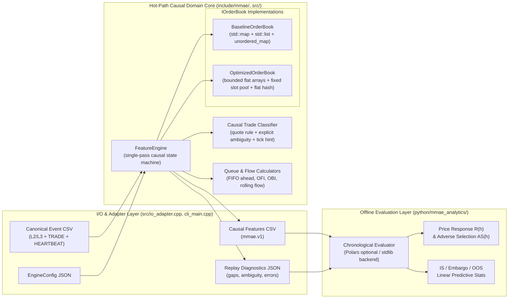
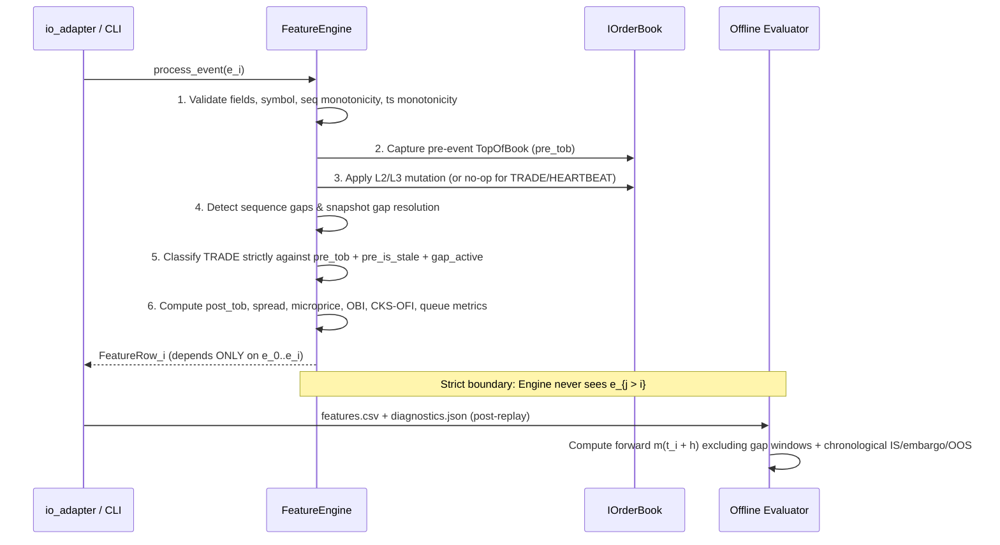

# Architecture — Market Microstructure Analytics Engine (MMAE)

## 1. Component Overview & Boundaries

MMAE enforces strict separation between three layers so that hot-path book reconstruction, I/O parsing, and forward-looking evaluation cannot contaminate one another:

---

## 2. Causal Event-Time Data Flow

For every incoming event $e_i$ at timestamp $t_i$ and sequence number $s_i$:

---

## 3. Core Invariants

1. **No future quote leakage (Prefix Invariance):**
   - `FeatureEngine::process_event` is an online single-pass state machine. Every emitted `FeatureRow` for event $i$ is a pure function of `(config, events[0..i])`. Mutating any event $j > i$ cannot change row $i$ (verified by both C++ and end-to-end Python regression tests).
2. **Exact integer tick keying:**
   - All resting prices are stored as `int64_t price_ticks`. Spreads, midpoint comparisons (`2 * trade_price_ticks` vs `best_bid_ticks + best_ask_ticks`), and book level lookups avoid floating-point comparison error.
3. **Explicit trade-sign ambiguity:**
   - Ambiguous trades (`MIDPOINT_AMBIGUOUS`, `BOOK_INCOMPLETE`, `BOOK_CROSSED`, `BOOK_LOCKED`, `BOOK_STALE`, `GAP_ACTIVE`) always emit `trade_sign = 0` (`AMBIGUOUS`) and `is_ambiguous = 1`. The causal `tick_rule_hint` is stored separately for diagnostics and never overwrites `trade_sign`.
4. **Bounded capacity on hot path:**
   - Both `BaselineOrderBook` and `OptimizedOrderBook` enforce `max_levels` and `max_orders`. Exceeding capacity returns an explicit `BOOK_CAPACITY_*_EXCEEDED` error instead of silently reallocating unbounded memory.
5. **Baseline vs Optimized logical equivalence:**
   - `BaselineOrderBook` (`std::map` + `std::list` + `std::unordered_map`) and `OptimizedOrderBook` (pre-allocated contiguous sorted level vectors + intrusive fixed-capacity order slot pool + zero-tombstone backward-shift open-addressing hash table) implement the identical `IOrderBook` contract and are verified to produce byte-for-byte identical feature CSV outputs.
6. **Chronological embargoed evaluation:**
   - Offline evaluation splits strictly in event time (`train_fraction`), inserts an embargo of $\max(h)$ between the last training timestamp and the first test timestamp so no IS target overlaps any OOS feature, standardizes features using IS moments only, and excludes gap-contaminated horizons.

---

## 4. Key Trade-Offs

- **Contiguous sorted level vectors vs direct tick-offset array in `OptimizedOrderBook`:**
  - Contiguous `std::vector<LevelEntry>` reserved to `max_levels` supports arbitrary sparse tick ranges (e.g., wide strikes or multi-decade price shifts) without fixed price-range overflows while keeping L1–L5 top-of-book access in a single L1 cache line. Binary search over typical active depths (~10–200 levels) is cache-resident and 1.64× faster than `std::map` node chasing while eliminating per-order heap allocation via the fixed slot pool.
- **CSV + JSON I/O boundary vs binary framing:**
  - Canonical CSV and JSON keep fixtures human-auditable and hand-verifiable. Binary framing (e.g., compressed book streams from sibling `order-book-compression-engine`) can plug cleanly into `IOrderBook`/`FeatureEngine` via a separate adapter without touching core domain logic (see `docs/integration.md`).
- **Optional Polars vs Python stdlib fallback:**
  - `mmae_analytics` automatically uses Polars when installed (`requirements.txt`), and falls back cleanly to Python standard library CSV/math routines with identical formulas so validation works out-of-the-box in offline minimal environments.
